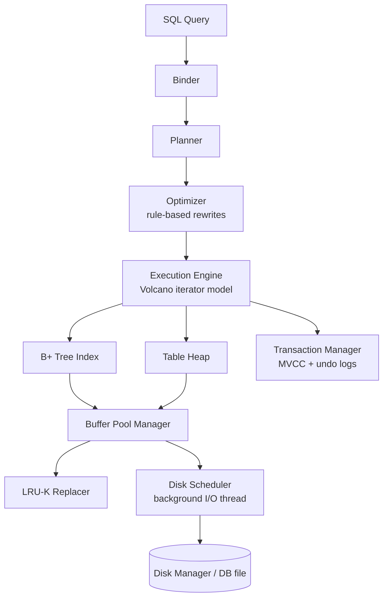

# Relational Database Engine in C++ (BusTub)

A disk-oriented relational database management system built in C++17 on top of **BusTub**, the educational DBMS from Carnegie Mellon University's *15-445/645 Database Systems* course.

Starting from the course skeleton, I implemented the core layers of the engine: storage and memory management, indexing, query execution, and transaction concurrency control. This README explains what each component does, how I designed it, and why.

> **Source code is private** in line with CMU 15-445's academic integrity policy, which asks that solutions not be published. Code is available to recruiters and interviewers on request.

---

## Architecture

A query moves top-down: it is bound, planned, optimized, then executed as a tree of operators. Every operator reads and writes data through pages, and every page access goes through the buffer pool.

| Layer | What I built |
|---|---|
| Memory / storage | Disk scheduler, LRU-K replacer, buffer pool manager, RAII page guards |
| Indexing | Concurrent B+ tree with point lookups, inserts, deletes and range-scan iterator |
| Query execution | Volcano-style executors, hash join, hash aggregation, sort/limit/top-N, optimizer rules |
| Concurrency control | MVCC with snapshot isolation, undo-log version chains, conflict detection, garbage collection |

---

## 1. Buffer Pool Manager

The buffer pool keeps a fixed number of in-memory **frames** that cache disk **pages**. Every other part of the system asks the buffer pool for a page by `page_id` and never talks to the disk directly.

### Disk Scheduler
- Callers do not do I/O themselves. They create a `DiskRequest` (read or write, page id, data buffer) and push it onto a shared request queue.
- A **background worker thread** pulls requests off the queue and issues them to the disk manager.
- Each request carries a `std::promise<bool>`; the caller waits on the matching `std::future` until its I/O completes.
- **Why:** this separates "deciding to do I/O" from "doing I/O," and keeps disk access in one place where it can be batched or reordered later.

### LRU-K Replacement Policy
When the pool is full and a new page is needed, the replacer chooses a victim frame.

- For each frame I record the timestamps of its **last K accesses**.
- The **backward k-distance** of a frame is `current_time − time of its K-th most recent access`.
- The frame with the **largest** backward k-distance is evicted.
- Frames with fewer than K recorded accesses have a distance of **+∞**. Among those, I evict the one with the **earliest** recorded access (classic LRU as a tie-breaker).
- Only frames marked **evictable** (pin count = 0) are candidates.

**Why LRU-K instead of LRU:** a single sequential scan touches each page once. Under plain LRU that scan pushes every hot page out of the cache. LRU-K only treats a page as "hot" after repeated accesses, so scans cannot flush the working set (*scan resistance*).

### Buffer Pool Manager
Core state:
- **Page table**: maps `page_id → frame_id` for pages currently in memory.
- **Free list**: frames that hold no page.
- **Per-frame metadata**: pin count, dirty flag, and a reader-writer latch.

Main operations:
- **Fetch a page**: on a hit, return the frame. On a miss, take a free frame or evict a victim from the replacer, **write the victim back to disk first if it is dirty**, then read the requested page in through the disk scheduler.
- **New page / delete page**: allocate or free page ids and update the page table and free list.
- **Flush**: write a page (or all pages) to disk and clear the dirty flag.

Each access pins the frame and records the access in the replacer. A pinned frame can never be evicted.

### Page Guards (RAII)
Forgetting to unpin a page leaks a frame forever, and forgetting to release a latch causes deadlocks. To prevent both, I return pages wrapped in guards:

- **`ReadPageGuard`** holds the frame's latch in **shared** mode.
- **`WritePageGuard`** holds it in **exclusive** mode and marks the page dirty.
- When a guard is destroyed (or `Drop()` is called), it **releases the latch, decrements the pin count, and marks the frame evictable** if no one else holds it.
- Guards are **move-only**: moving one transfers ownership, so a page is released exactly once.

**Concurrency:** one buffer-pool latch protects the page table, free list and replacer metadata; each frame's own latch protects that page's contents. This keeps threads working on different pages from blocking each other.

---

## 2. B+ Tree Index

A disk-backed B+ tree maps keys to record ids (`RID`) and supports unique keys.

### Page layout
- **Header page** stores the root page id, so the root can change (on a root split or merge) without callers needing to know.
- **Internal pages** store `n` keys and `n + 1` child page ids; the first key slot is unused.
- **Leaf pages** store sorted `(key, RID)` pairs and a **next-leaf pointer** that links all leaves in key order.

### Operations
- **Search**: descend from the root, using binary search inside each page to pick the child, until reaching the leaf.
- **Insert**: insert into the correct leaf in sorted order. If the leaf overflows, **split** it in half and **copy up** the first key of the new right leaf into the parent. If an internal page overflows, split it and **push up** the middle key. A root split creates a new root and updates the header page.
- **Delete**: remove the key from its leaf. If a page falls below half full, first try to **borrow** (redistribute) an entry from a sibling; if the sibling is also at minimum, **merge** the two pages and remove the separator key from the parent. Underflow can propagate up, and the tree shrinks when the root is left with a single child.
- **Range scans**: an **iterator** starts at a leaf and follows the next-leaf pointers, so a range scan never goes back up the tree.

### Concurrency: latch crabbing
Multiple threads can use the tree at once. I control this with **latch crabbing**, using page guards to hold page latches.

- **Reads**: latch the child, then release the parent. At most two pages are latched at any time.
- **Writes**: take write latches on the way down and keep the ancestors' latches **until reaching a "safe" node**: one that will not split on insert (not full) or merge on delete (more than half full). At a safe node, all ancestor latches are released, because changes cannot propagate above it.
- **Optimistic writes**: most inserts and deletes do not split or merge. I first descend with read latches and take a write latch only on the leaf. If the leaf turns out to be unsafe, I restart with the pessimistic protocol above.
- The write path keeps its latched pages in a per-operation **context** (a stack of write guards), so they are released in the right order automatically.

---

## 3. Query Execution

### Execution model
Executors follow the **Volcano (iterator) model**. Each executor implements:
- `Init()`: prepares state (for example, builds a hash table or resets a scan cursor).
- `Next(&tuple, &rid)`: returns the next output tuple, pulling from its child executors as needed.

The plan is a tree of executors. Calling `Next()` on the root pulls tuples up through the tree one at a time.

### Executors I implemented
- **Access**: `SeqScan` (iterates over the table heap and skips deleted tuples), `IndexScan` (uses the B+ tree for point and range lookups).
- **Modification**: `Insert`, `Update`, `Delete`. These change the table heap **and keep every index on the table consistent**, then return the number of rows affected.
- **Aggregation**: hash aggregation with `GROUP BY` and `COUNT`, `COUNT(*)`, `SUM`, `MIN`, `MAX`. It is a **pipeline breaker**: `Init()` consumes the whole child input into a hash table, and `Next()` emits one row per group. Empty-input edge cases follow SQL semantics (for example, `COUNT(*)` returns 0).
- **Joins**: `NestedLoopJoin` and `HashJoin`, for both `INNER` and `LEFT` joins. Hash join **builds** a hash table on the left input, then **probes** it with each right tuple, turning an `O(n·m)` join into roughly `O(n + m)`.
- **Ordering**: `Sort`, `Limit`, and `TopN` (a bounded heap that keeps only the top N rows instead of sorting everything).

### Optimizer rules
The planner's output is rewritten by rule-based optimizations:
- **Sequential scan → index scan** when the filter is an equality or range predicate on an indexed column.
- **Nested loop join → hash join** when the join condition is an equi-join (`a.x = b.y`, including conjunctions of equalities).
- **Sort + Limit → TopN**, which avoids sorting the full input.

---

## 4. Concurrency Control (MVCC)

Transactions use **multi-version concurrency control** with **snapshot isolation**: each transaction reads a consistent snapshot of the database, readers never block writers, and writers never block readers.

### Timestamps
- When a transaction starts, it gets a **read timestamp**: the latest commit timestamp at that moment.
- When it commits, it gets a new **commit timestamp**.
- Each tuple's metadata stores the timestamp of its latest version. While a transaction has uncommitted changes, the tuple carries that transaction's **temporary timestamp**, so other transactions know it is not yet visible.

### Version chains with undo logs
- The table heap always holds the **newest** version of each tuple.
- Older versions are stored as **undo logs**: records of which columns changed and their previous values, along with the timestamp of that version.
- Undo logs are linked into a **version chain** for each tuple.
- **Reading a tuple**: if its timestamp is at or before my read timestamp (or I wrote it myself), I use it directly. Otherwise I walk the undo chain, applying changes backward, until I reach a version with timestamp ≤ my read timestamp. If there is none, the tuple did not exist in my snapshot.

### Writes and conflicts
- Before modifying a tuple, a transaction creates an undo log so the previous version stays visible to older snapshots.
- **Write-write conflicts**: if a tuple has already been modified by another uncommitted transaction, or committed after my read timestamp, my transaction is marked **tainted** and must **abort**.
- On **commit**, I stamp the transaction's tuples with its commit timestamp so later transactions can see them.

### Garbage collection
- The **watermark** is the lowest read timestamp among running transactions.
- Undo logs older than the newest version visible at the watermark can never be read again, so they are removed to free memory.

### Index interaction
- Inserts, updates and deletes keep index entries consistent with the version visible to each transaction, so index scans and sequential scans return the same results.

---

## Testing and debugging

- Verified each component against the course's local test suites and the online grader's hidden tests (correctness, concurrency, and performance).
- Wrote extra unit tests for edge cases: eviction with all frames pinned, splits and merges at page boundaries, empty-input aggregation, and conflicting concurrent writers.
- Debugged concurrency issues (deadlocks, races, latch-ordering bugs) with **GDB** and **AddressSanitizer / ThreadSanitizer**, and checked for memory leaks.
- Followed the project's formatting and linting rules (`clang-format`, `clang-tidy`).

---

## What I learned

- **Why the buffer pool is the center of a DBMS:** almost every performance decision comes down to which pages stay in memory, and LRU-K shows why a naive cache policy fails under scans.
- **How to make a tree data structure safe under concurrency:** latch crabbing, "safe" nodes, and optimistic descent with a pessimistic fallback.
- **How SQL turns into physical operators,** and how simple rewrite rules (index scan, hash join, top-N) change the cost of a query.
- **How MVCC provides consistent snapshots** without readers and writers blocking each other, and the costs it adds: version chains, conflict aborts, and garbage collection.
- **Writing safe systems C++:** RAII for locks and pins, move semantics for ownership, and sanitizers to catch races and memory errors.

---

## Tech stack

C++17 · CMake · Linux · GDB · AddressSanitizer / ThreadSanitizer · clang-format / clang-tidy

## Acknowledgments

BusTub and the project specifications are by the [CMU Database Group](https://db.cs.cmu.edu/) for [15-445/645 Database Systems](https://15445.courses.cs.cmu.edu/). The design and explanations in this README describe my own implementation of those projects.
